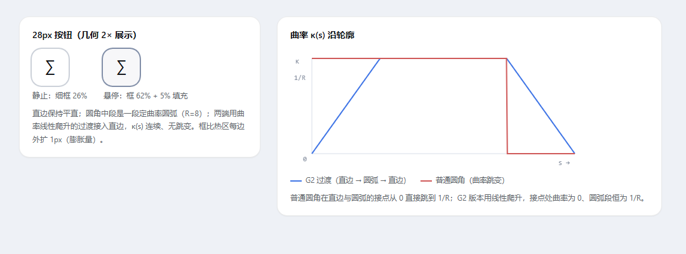

# dsh-mathpad（数学符号面板）

输入框上方一枚 `∑ 数学符号` 小按钮。点开是一个**草稿可直接编辑**的面板：符号填空、数字键盘补次数、实时显示“读作”，确认后插入输入框光标处。


## 入口位置

输入框右下角、**模型选择器左侧**的一枚 `∑` 小按钮（28×28，透明底，悬停才显底色），不再占用输入框上方整行。

- 注册在 `conversation.input.right`，`order: 1000`：这个列表按 order 升序排在模型选择器之前，所以永远是**紧贴模型左侧**；以后若有插件用更大的 order，我们自动左移。
- 点击时用 `inputActions.captureInsertion()` 记下输入框光标 + 草稿版本，再打开面板。

## 外框：G2 连续曲率圆角



普通 `border-radius` 的圆角是“直边 + 圆弧”：接点处曲率从 0 直接跳到 1/R，视觉上会有一道“拐角起笔”的硬点。这里的框改成 **G2 连续**：

- 四条边的中段是**真正的平直边**（曲率 0）；
- 靠近每个角，用**曲率线性爬升**的过渡段（布洛什式，0 → 1/R）接入；
- 圆角中段是一段**定曲率圆弧**（κ = 1/R，R = 8）；
- 过 45° 后对称回落，再回到直边。

因此 κ(s) 沿整条轮廓连续，没有跳变；用 SVG `path` 生成（每个角 44×10 采样），不依赖 `border-radius`。

可调参数（`client.js` 顶部）：

| 参数 | 值 | 作用 |
| --- | --- | --- |
| `FRAME_RADIUS` | 8 | 中段圆弧半径，决定圆角“硬”的程度 |
| `FRAME_TRANSITION` | 4.4 | 每端 G2 过渡长度；越大越柔和，但直边越短 |
| `FRAME_BULGE` | 1 | **向外膨胀量**（每边 px），框因此比 28px 热区大 2px |
| `FRAME_PADDING` | 1 | SVG 内留白，防止 1px 描边被裁 |

状态：静止描边 26%（几乎只是个暗示）；悬停 62% 描边 + 4.5% 填充；键盘焦点用品牌色描边。过渡 120ms，不做长渐变（“过渡浸润窗口”收短）。

位置：按钮加了 `margin-right: 2px`，外扩 1px 后也不会贴上模型选择器；`∑` 仍然是墨迹居中。

## 踩过的坑：样式表挂载位置

v3.4 及以前的 `client.js` 把 `<style>` 放在**弹窗组件**的返回值里。弹窗关闭时组件返回 
ull`，样式表跟着卸载——于是输入框旁边那个 `∑` 在平时根本没有样式，退回浏览器默认按钮：灰底方块、默认字号、不居中。这也是“改了 v3.2/v3.3/v3.4 看起来都没区别”的真正原因。

现在的做法：

- `apply(ctx)` 里用 `ctx.effect(() => installStyles())` 把 CSS 一次性插到 `<head>`，插件卸载时移除；
- 触发按钮从 `<button>` 改成 `div[role=button]`（保留 Tab/Enter/Space），绕开宿主给 composer 内 `<button>` 的默认样式；
- 冒烟测试新增断言：`apply` 后 `<head>` 里必须恰好有一份样式表，且包含 `.mss-trigger`。

## 对齐方式：墨迹在盒子里垂直居中

之前按“和邻居的墨迹中轴对齐”算，结果 `∑` 在自己 28×28 的盒子里上下留白不等：上 10.5px、下 6.3px——看着还是往下坠。

现在改成**只看自己**：

- 盒子（28×28）由宿主那一行居中，和模型选择器、发送按钮同轴；
- 字形 12px、继承字体，不换字体；
- 用 canvas 的 `actualBoundingBoxAscent/Descent`（墨迹）和 `fontBoundingBoxAscent/Descent`（em 盒）算出“em 盒中心 − 墨迹中心”，用 `translateY()` 把墨迹挪到盒子中心；
- 量的时候字号放大 10 倍再除以 10，绕开 Chrome 只给整数像素的量化误差；
- 结果是上下各 8.4px，绝对相等；量不出来时 CSS 兜底 `-2.1px`。

对照：[docs/align-check.html](docs/align-check.html)（旧：盒子居中 10.5/6.3 vs 新：墨迹居中 8.4/8.4）。
## 这一版解决的三个问题

1. **草稿能编辑了**：草稿就是一个普通输入框，点符号是“往光标处填空”，也可以直接打字、退格、按光标插入。
2. **幂次用 Unicode 上标**：键盘区的 `ⁿ` 展开上标数字（`⁰¹²³⁴⁵⁶⁷⁸⁹ⁿ`），点一下就插入字符本身——`x²`、`e³`、`sin²x`，不再有“空格表示次方”的隐规则。上标紧跟函数名表示函数的幂：`sin²x` 读作 `(sin x)²`。
3. **分式模板**：`分式` 键插入 `( )/( )` 并把光标放进分子，`∫sinx/(1+sinx)dx` 这类式子不用写除号；TeX 模式会转成 `\frac{}{}`。
3. **按数学角色重新分组**：变量与常量（`x y z a b n t θ π e ∞`，另有 `a–z` 字母条）、函数、幂与根、微积分运算符（`∫ ∮ ∂ ∑ ∏ ∐ ∇ Δ` 与希腊字母）、运算与括号，共 55 个常驻符号；关系符这类用不到的不再占地方（要就手打）。

## 两种模式（右上角切换，会记住）

- **草稿模式（默认）**：点符号先拼在面板里，看着“读作”确认后，一次插入到输入框。适合整段式子。
- **直插模式**：点符号/数字**直接写进聊天框**，面板不关，可以连着点；拼完按 `完成`。适合边写边补，省掉“再插入一次”。

两种模式共用同一套符号和数字键盘；直插模式没有草稿输入框，因为文字直接落在聊天框里。

## LaTeX 模式（右上角 `TeX` 切换，会记住）

打开后，插入时把草稿转成 LaTeX：

| 草稿 | 插入的 LaTeX |
| --- | --- |
| `limx→0 sinx` | `\lim_{x \to 0} \sin x` |
| `sin²x` | `\sin^{2}x` |
| `(sinx)/(1+sinx)` | `\frac{\sin x}{1+\sin x}` |
| `∫` / `∮` / `∂` | `\int` / `\oint` / `\partial` |
| `√x` | `\sqrt{x}` |

底部“读作”会换成 `LaTeX` 预览，插入前能确认。转换只覆盖面板里出现过的写法和几个常见组合，不是完整的 TeX 解析器；`\lim` 只有在后面跟着含 `→` 的一段时才收进下标，避免把普通参数误当下标。

## 模板

`lim→` 和 `∫ₐᵇ` 点一下会打开**独立的填空页**：两个空位同时显示，可以直接点任意一个；下方只保留变量/常量和数字键（仍可手动输入），点键写入当前聚焦的空。按 `Enter` 或**点页面空白处**把结果插回草稿并返回主面板（两个空都没填时插入原格式 `lim()→()`）；`Esc` 或「← 返回」取消。`√ⁿ` 仍是直接插入。填好的模板按两个主体删除：`lim(x)→(0)` 先删 `(x)→(0)`，再删 `lim`；`∫_(0)^(1)` 同理。

| 模板 | 插入 | 填完的 LaTeX |
| --- | --- | --- |
| `lim→` | `lim()→()` | `lim(x)→(0)` → `\lim_{x \to 0}` |
| `∫ₐᵇ` | `∫_()^()` | `∫_(0)^(1)` → `\int_{0}^{1}` |
| `√ⁿ` | `√[]()` | `√[3](x)` → `\sqrt[3]{x}` |

## 用法

- 点符号：**高亮跟着鼠标走**——移到哪一格，哪一格就是选中；单击输出当前高亮的那一格，`Enter` 同样输出当前选中项。
- 数字键 0–9：直接补数字。
- `空格`：普通分隔符（不再是“次方”）。
- `分式`：插入 `( )/( )`，光标落在分子里。
- `ⁿ`：展开一行 Unicode 上标（`⁰¹²³⁴⁵⁶⁷⁸⁹ⁿ`），点一下插入对应上标。
- `⌫ 删除`：草稿先按符号序列切分（长名优先），`limcosx → [lim, cos, x]`、`arcsinsinx → [arcsin, sin, x]`；光标前是完整函数名就一次删掉，否则删一个字符（原生 Backspace 同样适用）。
- **键盘导航**：鼠标移入分区即选中第一格（单一焦点环）；方向键在分区内移动，到边界进入相邻分区（包括最后的数字键盘区）；`Enter` 在面板任何位置都会输出当前选中项（包括焦点在草稿框时）；`Tab` 切换分区，`Shift+Tab` 切 TeX；**鼠标停在草稿区时方向键交还给光标**。`Esc` 才是关闭。
- 草稿下方“读作”实时翻译，确认没歧义再插入。
- 右上角 `TeX` 打开后，插入的是 LaTeX（底部预览同步切换）。
- `最近` 行：面板顶部显示最近 12 个插入过的符号/模板（6 列 × 2 行），点一下复用（存 `localStorage`）。
- `Ctrl+Shift+M`：输入框聚焦时直接打开面板，不用去点 `∑`。
- `Enter` 插入当前选中项（直插模式下为完成）· `Esc` 关闭 · `Shift+Tab` 切换 TeX 模式。

## 输入约定

仍然沿用我们原来的写法，面板只负责帮你写对、看懂：

| 草稿 | 读作 | 规则 |
| --- | --- | --- |
| `sin²x` | `(sin x)²` | 上标紧跟函数名 = 函数的幂 |
| `sin3x` | `sin(3x)` | 没有空格 = 倍数（保留旧写法） |
| `e3` / `ex` | `e³` / `eˣ` | e 后面的数字是指数 |
| `x5` / `x2` | `x⁵` / `x²` | x 后面的数字是指数 |

插入时发送的是**草稿原文**（如 `sin²x`）；只有打开 `TeX` 时才会换成 LaTeX 写法。

## 文件结构

```
math-symbols/
  package.json        # 包清单：dsh.bundle.patch + dsh.client 配置
  cordis.patch.yml    # 向 profile 插入 id=math-symbols 这一行
  index.js            # Host 半边（空实现，渲染全在 Client）
  client.js           # Client 半边：右下角 ∑ 触发按钮 + shell.overlay 面板
  locale/{zh,en}.json # 插件列表里的标题/描述
  icon.svg            # 插件图标
  docs/design-panel.* # 设计稿（html + png）
  test/smoke.mjs      # 冒烟测试（不需要浏览器）
```

## 实现要点

- 触发按钮注册在 `conversation.input.right`（会话作用域，能拿到 `inputActions`），`order: 1000` 让它紧贴模型选择器左侧。
- 点击时用 `inputActions.captureInsertion()` 记下输入框光标 + 草稿版本，再打开面板。
- 面板注册在 `shell.overlay`（应用根级浮层），关闭时返回 
ull`，不占空间。
- 两个插槽的组件通过模块级状态共享“打开 / 草稿 / 光标位置”。
- 插入时用打开时记下的 span 调 `inputActions.insertText`；版本对不上就重新捕获光标重试，最多 3 次；仍失败退回剪贴板。
- 全部样式走 `--dsw-alias-*` 主题变量，亮/暗主题都能用。

## 怎么确认你看到的是新版

改 `client.js` **不会热更新**：Client 模块在页面启动时加载一次，必须刷新（`Ctrl+R`），不行就退出重开 DSH。为了不用猜，三处都可查：

1. 打开面板，底部有一行 `v0.1.0`；
2. 浏览器控制台会打印 `[dsh-mathpad] client v0.1.0 loaded`（附一句刷新提示）；
3. 设置 → 插件里 `dsh-mathpad` 的版本号。

三处任一没变，就说明页面里还是旧模块。

## 安装与更新

插件通过 `link:` 挂在 desktop profile 上，**本文件夹就是唯一源**；改完 `client.js` 后重载页面（`Ctrl+R`）生效，不用重装。

## 测试

```powershell
$env:ELECTRON_RUN_AS_NODE='1'
& $env:DSH_NODE_EXECUTABLE .\test\smoke.mjs
```

覆盖：两个插槽注册、样式挂载、G2 路径闭合、5 个分组共 39 个符号、变量 `x`/`θ`、a–z 字母条展开/收起、Unicode 上标（`sin²x → (sin x)²`）、分式模板、键盘导航（悬停分区→方向键→Enter）、LaTeX（`sin²x`、`θ`、`(sinx)/(1+sinx)`）、退格、Esc、插入复用打开时的光标、版本冲突重试。
